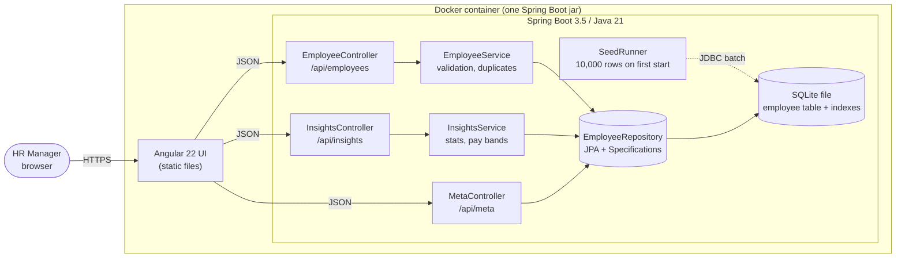

# Architecture

One deployable unit: a Spring Boot app that serves both the REST API (`/api/**`) and the built Angular app (everything else). One port, one container, no CORS.



## Backend packages (`backend/src/main/java/com/acme/salary`)

| Package | Responsibility |
|---|---|
| `country` | `Country` enum: the 8 supported countries, their currency and static USD reference rate. Currency is derived from the country, so they can never disagree. |
| `employee` | Entity, repository, service (business rules), controller, request/response records, `EmployeeSpecifications` (filters → SQL WHERE). |
| `insights` | `SalaryStats` (pure min/median/average/max function), `InsightsService` (grouping, USD totals, pay-band flags), controller, DTOs. |
| `seed` | `EmployeeGenerator` (pure, deterministic data generator) and `SeedRunner` (inserts on first start). |
| `common` | Paged response shape, exceptions, `ApiExceptionHandler` (RFC 7807 Problem Details). |
| `web` | Dropdown metadata and the Angular route forwarding. |

## Frontend (`frontend/src/app`)

| Folder | Responsibility |
|---|---|
| `core` | Typed models, `ApiService` (only place that knows URLs), money formatting. |
| `employees` | Directory page (filters, sort, paging) and add/edit dialog. |
| `insights` | Overview cards, pay by country, pay by job title with range bars and pay-band flags. |
| `shared` | Confirmation dialog. |

State lives in **signals**; server data is loaded with **`rxResource`**, which re-fetches automatically whenever its parameters (the filter/sort/page signals) change and cancels the previous request. All components are standalone and `OnPush`; the app is zoneless.

## API

| Method & path | Purpose |
|---|---|
| `GET /api/employees?search&country&department&jobTitle&page&size&sortBy&direction` | Paged, filtered, sorted directory |
| `GET /api/employees/{id}` | One employee |
| `POST /api/employees` | Create (201, 400 field errors, 409 duplicate) |
| `PUT /api/employees/{id}` | Update (200, 400, 404, 409) |
| `DELETE /api/employees/{id}` | Delete (204, 404) |
| `GET /api/insights/overview` | Headcount, countries, job titles, payroll and average in ≈USD |
| `GET /api/insights/countries` | Stats per country in local currency |
| `GET /api/insights/countries/{code}/job-titles` | Stats per job title in one country + pay-band outlier counts |
| `GET /api/meta` | Countries, departments, job titles for dropdowns |

## Data model

```
employee
  id             INTEGER PK
  employee_code  TEXT UNIQUE      -- HR's own code, e.g. EMP00042
  full_name      TEXT
  email          TEXT UNIQUE      -- stored lower-case
  job_title      TEXT   (indexed)
  department     TEXT   (indexed)
  country_code   TEXT   (indexed) -- IN, US, GB, DE, CA, AU, SG, AE
  salary         NUMERIC CHECK > 0 -- annual gross, local currency
  hire_date      TEXT             -- ISO yyyy-MM-dd
```
